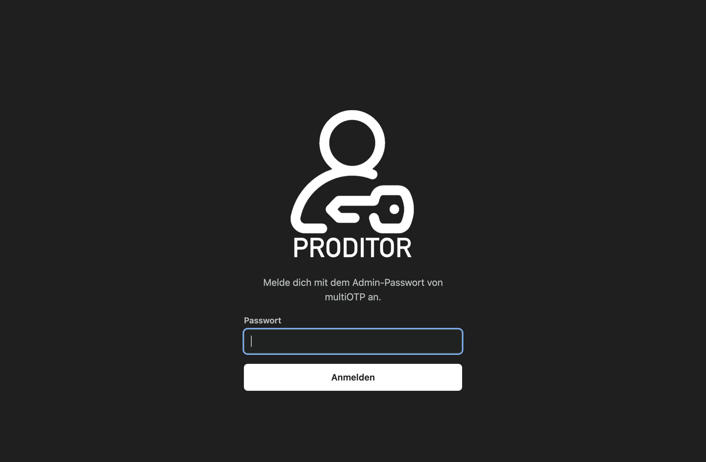

# Proditor-admin

Eine moderne Weboberfläche für [multiOTP](https://github.com/multiOTP/multiotp) (getestet mit 5.10.2.2 und PHP 8.4). Sie wird zusätzlich zur mitgelieferten Konsole installiert und ersetzt sie im Alltag.



## Funktionen

- Benutzerliste mit Sofortsuche nach Name, Beschreibung, Seriennummer und E-Mail
- Filter für HOTP, TOTP, Without2FA, Dual-Token (`benutzer#2`) und gesperrte Benutzer
- Eigene Spalte für Fehlversuche
- **Zählerstand von HOTP-Sticks direkt setzen.** Eingegeben wird der nächste Zählerstand (`last_event + 1`). Beim Zurücksetzen erscheint eine Warnung, weil alte Codes dann wieder gelten.
- Code prüfen, Resync mit zwei Codes, Sperren und Entsperren
- Benutzer anlegen mit Proditor-Stick (HOTP, Auswahl aus freien importierten Sticks), QR-Code (TOTP) oder Without2FA. Eine eingetragene PIN muss immer vor dem Code eingegeben werden.
- Löschen erst nach Eingabe des Benutzernamens
- Direktlinks: `/admin/#u=benutzername`
- Hell- und Dunkelmodus, auch auf dem Handy bedienbar

## Sicherheit

- Anmeldung mit dem bestehenden multiOTP-Admin-Passwort
- Nach 5 Fehlversuchen wird die IP für 5 Minuten gesperrt.
- Sitzungs-Cookie mit `Secure`, `HttpOnly` und `SameSite=Strict`, CSRF-Token für jede Änderung
- Content-Security-Policy ohne Inline-Skripte
- Versionen von multiOTP und PHP sind erst nach der Anmeldung sichtbar.
- Jede Änderung wird mit IP im multiOTP-Log vermerkt (`Verwaltung (Proditor, …)`).

## Installation

Voraussetzung ist ein multiOTP-Server mit nginx und php-fpm. Der Programmcode liegt unter `/usr/local/bin/multiotp`, die Daten unter `/etc/multiotp`.

```sh
git clone https://github.com/proditor2FA/Proditor-admin.git
cd Proditor-admin
sudo ./install.sh
```

`install.sh` kopiert die Dateien nach `/usr/local/bin/multiotp-admin` und erkennt den php-fpm-Socket selbst. Die Blöcke aus [`docs/nginx-multiotp.conf`](docs/nginx-multiotp.conf) fügt es einmalig in `/etc/nginx/sites-available/multiotp` ein und sichert die Datei vorher. Danach prüft es die Konfiguration und lädt nginx neu. Du kannst es gefahrlos erneut ausführen, zum Beispiel für ein Update.

Der erste Block leitet nur Browser von `/` auf `/admin/` um. `POST /` für den multiOTP-Webservice und Monitoring-Abfragen wie `check_http` landen weiter bei `multiotp.server.php`. Die alte Konsole bleibt unter `/multiotp.server.php` erreichbar.

Die Oberfläche greift direkt auf die multiOTP-Klasse und deren Dateien zu. Ein Update von multiOTP überschreibt sie nicht.

## Tests

`test_api.py` läuft als root auf dem Server und prüft die API gegen die echte Installation, zum Beispiel Login-Schutz, Zähler, Resync und das Anlegen der drei Token-Arten. Dafür legt es Testbenutzer (`proditor-test*`) und einen Test-Stick an und löscht sie am Ende wieder.

```sh
python3 test_api.py
```

## Lizenz

Copyright (C) 2026 proditor2FA

Dieses Programm ist freie Software: Du kannst es unter den Bedingungen der **GNU Lesser General Public License** weitergeben und verändern, wie von der Free Software Foundation veröffentlicht, entweder Version 3 der Lizenz oder (nach deiner Wahl) jede spätere Version (`LGPL-3.0-or-later`). Das ist dieselbe Lizenz wie bei multiOTP.

Das Programm wird in der Hoffnung verbreitet, dass es nützlich ist, aber **ohne jede Gewährleistung**, auch ohne die stillschweigende Gewährleistung der Marktgängigkeit oder der Eignung für einen bestimmten Zweck. Details stehen in [`COPYING.LESSER`](COPYING.LESSER) (LGPLv3) und [`COPYING`](COPYING) (GPLv3, auf der die LGPLv3 aufbaut).
